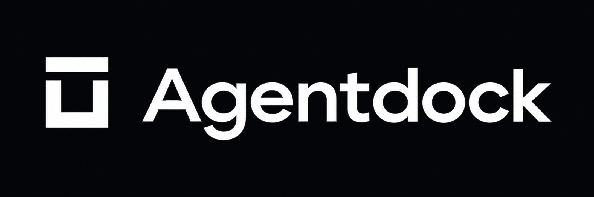

<div align="center">
  <p></p>
  <p>
    <a href="https://github.com/agentdock-ai/agentdock-starter"></a>
    
    
    
    
  </p>
  <p><strong>A simple, persistent chatbot built with Agentdock, LangGraph, and your choice of Node.js backend.</strong></p>
</div>

Agentdock Starter is a small full-stack Node.js application that shows how to
build a streaming chat assistant with durable conversations. Choose an Express,
Fastify, or NestJS backend; all three run the same AgentDock application and
expose the same API to one React frontend. PostgreSQL stores graph checkpoints
and conversation data.

## What’s included

- Streaming assistant replies with tool activity and approval prompts.
- Persistent threads and message history backed by PostgreSQL.
- A sandbox workspace with tools for listing, reading, and editing files.
- Human approval before file deletion or running a `.mjs` script.
- One React chat UI with thread selection, image attachments, and history reload.
- Three interchangeable backend adapters over a shared AgentDock server core.

## Stack

| Area        | Technology                                                  |
| ----------- | ----------------------------------------------------------- |
| Backends    | Node.js 22.18+, TypeScript, Express 5, Fastify 5, NestJS 11 |
| Agent       | Agentdock, LangGraph, LangChain                             |
| Model       | OpenRouter                                                  |
| Persistence | PostgreSQL checkpointer and Store                           |
| Frontend    | React, Vite, Agentdock React client                         |

## Run locally

This development checkout uses the sibling `agentdock` and `agentdock-ui`
repositories through local workspace links. Build their packages and UI registry
first:

```sh
yarn --cwd ../agentdock build
yarn --cwd ../agentdock-ui build:packages
yarn --cwd ../agentdock-ui registry:build
yarn --cwd ../agentdock-ui cli:build
```

Then install dependencies and configure the shared environment file:

```sh
yarn install
cp .env.example .env
```

Set `DATABASE_URL`, `OPENROUTER_API_KEY`, and `OPENROUTER_MODEL` in `.env`.
Start PostgreSQL and select one backend:

```sh
docker compose up -d
yarn dev:express
# Or choose one of these:
yarn dev:fastify
yarn dev:nestjs
```

Open [http://127.0.0.1:5173](http://127.0.0.1:5173). Every backend uses
[http://127.0.0.1:3000](http://127.0.0.1:3000), so the frontend proxy and API
contract stay the same. `yarn dev` selects Express by default. The
`yarn start:<backend>` commands start the selected backend without watch mode.
Run only one backend at a time on the default port.

The conversations handler publishes its OpenAPI document at
[`http://127.0.0.1:3000/openapi.json`](http://127.0.0.1:3000/openapi.json) and
interactive Swagger UI at [http://127.0.0.1:3000/docs](http://127.0.0.1:3000/docs).
The docs page loads Swagger UI assets from jsDelivr, so a browser needs internet
access to render the interface.

## Project layout

```text
backends/express/       Express HTTP adapter and server entry point
backends/fastify/       Fastify HTTP adapter and server entry point
backends/nestjs/        NestJS HTTP adapter and server entry point
packages/server-core/   Shared runtime, tools, sandbox, prompt, database, and conversation setup
frontend/               One React chat application and editable UI components
```

The server-core workspace creates the shared Fetch-compatible conversations
handler. Each backend forwards requests to it through Agentdock's Node HTTP
adapter, preserving streaming, uploads, and client-disconnect handling. LangGraph
owns graph execution and checkpoint state; PostgreSQL Store records hold the
conversation catalog and display history. The trusted assistant instructions
live in
[`packages/server-core/prompts/assistant.md`](./packages/server-core/prompts/assistant.md)
and are loaded once during server startup; workspace files cannot replace them.

## Commands

| Command                                                         | Purpose                                                        |
| --------------------------------------------------------------- | -------------------------------------------------------------- |
| `yarn dev`                                                      | Run Express and the frontend (default)                         |
| `yarn dev:express`, `yarn dev:fastify`, `yarn dev:nestjs`       | Run the selected backend and the frontend                      |
| `yarn start:express`, `yarn start:fastify`, `yarn start:nestjs` | Run the selected backend without watch mode                    |
| `yarn build`                                                    | Build the shared core, all backends, and frontend              |
| `yarn typecheck`                                                | Typecheck the shared core, all backends, and frontend          |
| `yarn test`                                                     | Run shared core tests and HTTP adapter contract tests          |
| `yarn ci`                                                       | Run formatting checks, tests, and the build                    |
| `yarn ui:add`                                                   | Refresh the starter chat components from the local UI registry |

Database-backed verification uses a disposable PostgreSQL database:

```sh
AGENTDOCK_TEST_DATABASE_URL=postgresql://.../agentdock_test yarn test:db
AGENTDOCK_TEST_DATABASE_URL=postgresql://.../agentdock_test yarn test:load
```

The test database name must contain `test`. The load command reports a local
synthetic baseline, not a production capacity claim.

## Deployment note

The supported deployment runs one execution-owning backend process. The Store
does not coordinate graph execution across multiple workers. This demo also uses
a fixed server-side user ID and binds to loopback; add application
authentication and trusted user identity before exposing it to users.
